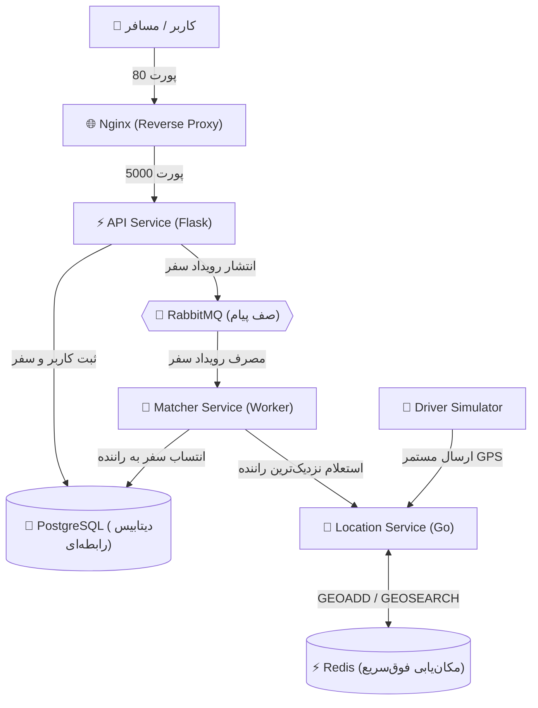
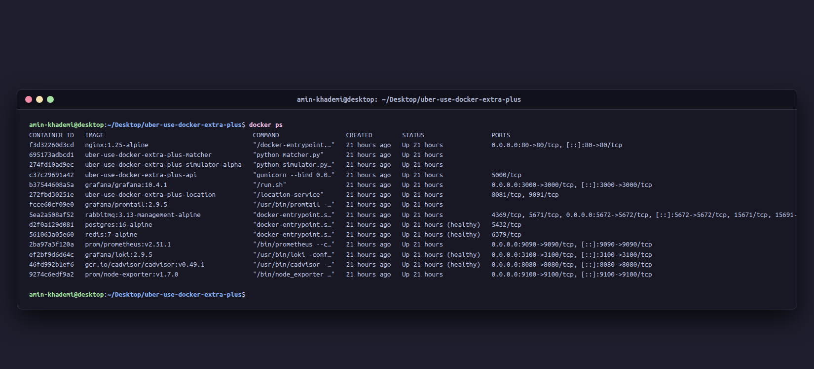

# 🚗 GeoRide (Uber-Like Microservices Architecture with Docker & Monitoring)

یک سیستم شبیه‌ساز حمل‌ونقل شهری و تاکسی اینترنتی (مشابه اوبر، اسنپ و تپسی) با معماری میکروسرویس ناهمگام (Event-Driven & Asynchronous) پیاده‌سازی‌شده با **Docker Compose**، همراه با پایپ‌لاین **CI/CD در GitHub Actions** و پشته کامل پایش و لاگینگ (**Prometheus, Grafana, Loki**).

---

## 🏛️ معماری و سرویس‌های پروژه

این پروژه از **۷ سرویس عملیاتی اصلی** به همراه ابزارهای ناظر تلمتری و مانیتورینگ تشکیل شده است:



### معرفی ۷ سرویس اصلی پروژه

| ردیف | نام سرویس | ایمیج / بیس | کاربرد و نقش در پروژه | ارتباط با سایر سرویس‌ها |
| :---: | :---: | :---: | :---: | :---: |
| **۱** | `postgres` | `postgres:16-alpine` | ذخیره‌سازی ماندگار رانندگان، مسافران و سوابق سفرها (`trips`, `users`) | با `api` جهت درج اولیه و با `matcher` جهت انتساب راننده به سفر |
| **۲** | `rabbitmq` | `rabbitmq:3.13-management-alpine` | کارگزار پیام (AMQP) جهت نامتقارن‌سازی (Decoupling) و پاسخ آنی به کاربر | `api` به آن پیام می‌فرستد (Producer) و `matcher` پیام‌ها را برمی‌دارد (Consumer) |
| **۳** | `redis` | `redis:7-alpine` | دیتابیس حافظه‌ای In-Memory برای محاسبات جغرافیایی و ذخیره مختصات زنده راننده‌ها | مستقیماً توسط `location` با دستورات `GEOADD` و `GEOSEARCH` استفاده می‌شود |
| **۴** | `nginx` | `nginx:1.25-alpine` | درگاه ورودی (API Gateway) و ریورس پروکسی روی پورت 80 | ترافیک بیرونی کاربران را به کانتینر داخلی `api:5000` هدایت می‌کند |
| **۵** | `api` | بیلد پایتون (`python:3.11-slim`) | وب‌سرویس REST برای ثبت‌نام مسافر، درخواست سفر و استعلام وضعیت | پشت Nginx قرار دارد؛ با Postgres و RabbitMQ در تبادل است |
| **۶** | `location` | بیلد چندمرحله‌ای Go (`scratch`) | موتور محاسبات داده‌های مکانی در شعاع ۵ کیلومتری با کارایی بالا | دریافت GPS از شبیه‌ساز، ذخیره در Redis و پاسخ به استعلام‌های Matcher |
| **۷** | `matcher` | بیلد پایتون (`python:3.11-slim`) | ورکر پس‌زمینه برای تطبیق هوشمند سفر با نزدیک‌ترین راننده | شنود RabbitMQ، استعلام راننده از Location Service و آپدیت سفر در Postgres |

### سرویس‌های نظارتی و مانیتورینگ (Extra-Plus)
- **`driver_simulator`**: شبیه‌ساز راننده پیش‌فرض (`Driver-Alpha`) جهت ارسال پیوسته مختصات GPS در شهر.
- **`prometheus`**: جمع‌آوری دوره‌ای متریک‌ها از کانتینرها و سیستم روی پورت `9090`.
- **`grafana`**: داشبوردهای مصورسازی متریک‌ها و لاگ‌ها روی پورت `3000`.
- **`cadvisor`**: پایش لحظه‌ای منابع مصرفی داکر (CPU، رم، I/O) روی پورت `8080`.
- **`node-exporter`**: متریک‌های لایه سیستم‌عامل سرور روی پورت `9100`.
- **`loki`** و **`promtail`**: سیستم متمرکز جمع‌آوری و مدیریت لاگ‌های کانتینرها روی پورت `3100`.

---

## 🚀 راهنمای راه‌اندازی و اجرا

### پیش‌نیازها
- ابزار Docker و Docker Compose

### مراحل اجرا
۱. کلون کردن مخزن:
```bash
git clone https://github.com/amin-khademi/uber-use-docker-extra-plus.git
cd uber-use-docker-extra-plus
```

۲. تنظیم متغیرهای محیطی:
```bash
cp .env.example .env
```

۳. ساخت و اجرای تمامی سرویس‌ها:
```bash
docker compose up --build -d
```

۴. بررسی وضعیت سلامت کانتینرها:
```bash
docker ps
```

---

## 🧪 تست و اعتبارسنجی اندپوینت‌ها

۱. **ثبت یک مسافر جدید:**
```bash
curl -X POST http://localhost/register \
  -H "Content-Type: application/json" \
  -d '{"name": "Carlos", "type": "rider"}'

# خروجی مورد انتظار:
# {"message":"Rider registered successfully","user_id":4}
```

۲. **ارسال درخواست سفر ناهمگام:**
```bash
curl -X POST http://localhost/request_ride \
  -H "Content-Type: application/json" \
  -d '{"rider_id": 4, "latitude": 34.05, "longitude": -118.24}'

# خروجی آنی:
# {"message":"Ride request received. Searching for a driver.","trip_id":1}
```

۳. **بررسی عملکرد ورکر مچینگ در لاگ‌ها:**
```bash
docker compose logs -f matcher
```
مشاهده لاگ‌های تطبیق:
```text
matcher-1  | [*] Waiting for ride requests. To exit press CTRL+C
matcher-1  | [x] Received ride request: {'trip_id': 1, 'rider_id': 4, 'latitude': 34.05, 'longitude': -118.24}
matcher-1  | [*] Found nearest driver: Driver-Alpha
matcher-1  | [*] Successfully assigned driver Driver-Alpha (ID: 1) to trip 1
```

۴. **استعلام وضعیت سفر (بررسی انتساب موفقیت‌آمیز راننده):**
```bash
curl http://localhost/trip/1

# خروجی نهایی:
# {"driver_id":1,"status":"assigned"}
```

---

## 📸 وضعیت کانتینرهای اجراشده (`docker ps`)



---

## 🔄 پایپ‌لاین CI/CD در GitHub Actions

این پروژه مجهز به گردش‌کار خودکار CI/CD در مسیر `.github/workflows/ci-cd.yml` است که شامل مراحل زیر می‌باشد:
1. **Lint & Configuration Check:** اعتبارسنجی سینتکس و صحت تنظیمات `docker-compose.yml`.
2. **Build & Integration Smoke Tests:** بیلد ایمیج‌ها، اجرای کانتینرها در محیط گیت‌هاب، بررسی Healthcheckها و ارسال درخواست‌های تستی با `curl` به اندپوینت‌های رجیستر، ثبت سفر و استعلام مچینگ.
3. **Docker Hub Deployment:** در صورت تنظیم بودن `DOCKERHUB_USERNAME` و `DOCKERHUB_TOKEN` در قسمت Repository Secrets گیت‌هاب، ایمیج‌های میکروسرویس‌ها بیلد و در داکر هاب منتشر می‌شوند.

### تنظیمات امن داکر هاب در گیت‌هاب
جهت انتشار ایمیج‌ها، در مخزن گیت‌هاب به مسیر **Settings > Secrets and variables > Actions** مراجعه کرده و دو متغیر زیر را ثبت کنید:
- `DOCKERHUB_USERNAME`: نام کاربری داکر هاب
- `DOCKERHUB_TOKEN`: توکن دسترسی شخصی (Access Token) از داکر هاب